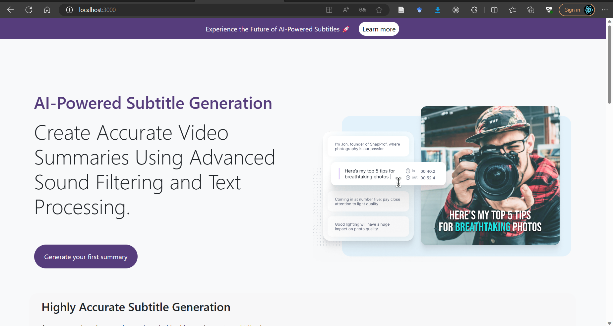
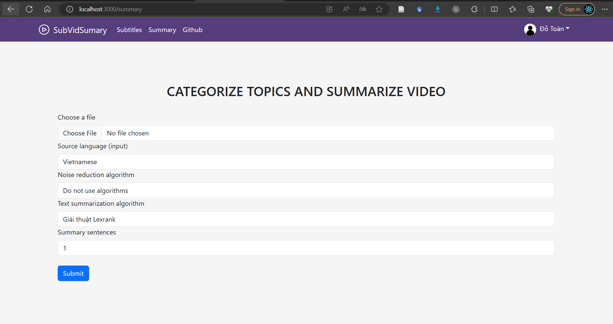
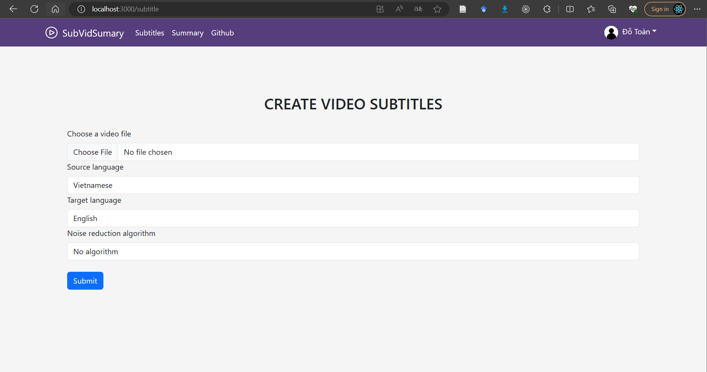
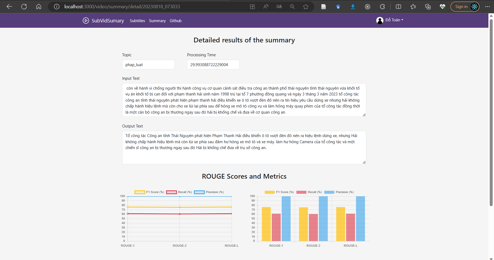
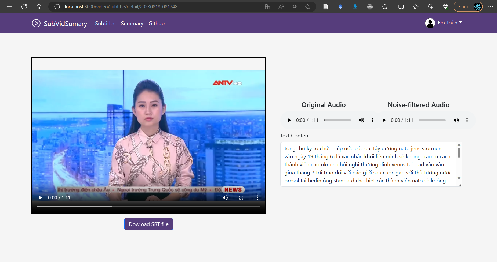

# Video subtitles and summaries

A 2023 academic application integrating video upload, noise reduction, speech recognition, subtitle generation and extractive summaries. It combines React, Express/MongoDB and a Python Flask worker.

This is a historical academic prototype. The 2026 maintenance pass updates configuration, access checks and repository hygiene. The application has not been validated end to end with its original runtime and external services.

## Structure and local setup

- `client/`: React interface for authentication, processing jobs and result history.
- `server/`: Express API, ownership checks, private upload-owner records and MongoDB models.
- `server/python_scripts/`: subtitle and summarization pipelines.
- `image/`: original interface screenshots.

Copy `server/.env.example` to `server/.env`. Configure local MongoDB and distinct random `ACCESS_TOKEN_SECRET` and `FLASK_SERVICE_TOKEN` values of at least 32 characters. The Flask worker reads the same file and accepts authenticated requests from Express. Set `GOOGLE_SPEECH_API_KEY` only for the legacy recognizer.

After configuring the historical dependencies, original entry points are:

```sh
# From server/
npm run seed
npm start
# From server/, in another terminal
python3 python_scripts/app.py
# From client/, in another terminal
npm start
```

The pipeline requires FFmpeg and, for the relevant option, DeepFilterNet. API keys, provider compatibility and the original audio environment have not been exercised during cleanup.

Uploads require login, use generated filenames and are limited to 256 MiB. The client waits for upload completion before submitting a job. Result lookups are scoped to their owner. Sessions expire after one hour; an HttpOnly cookie supports protected media playback. Use `localhost` consistently in local frontend/backend URLs.

## Research context

The original summarization pipeline reports overlap against the source transcript. Those ROUGE numbers are not a benchmark against independent human-written summaries. Related work is documented in [Text-BasedVideoSummarizer](https://github.com/toandokhanh/Text-BasedVideoSummarizer) and [VidSubWizard](https://github.com/toandokhanh/vid-sub-wizard).

## Screenshots







See [third-party notices](THIRD_PARTY_NOTICES.md). No repository-wide MIT license is claimed without an accompanying license file and verified rights for included components.
